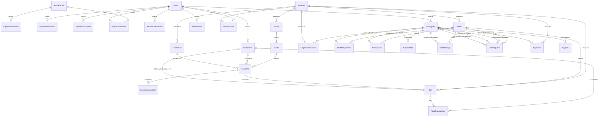
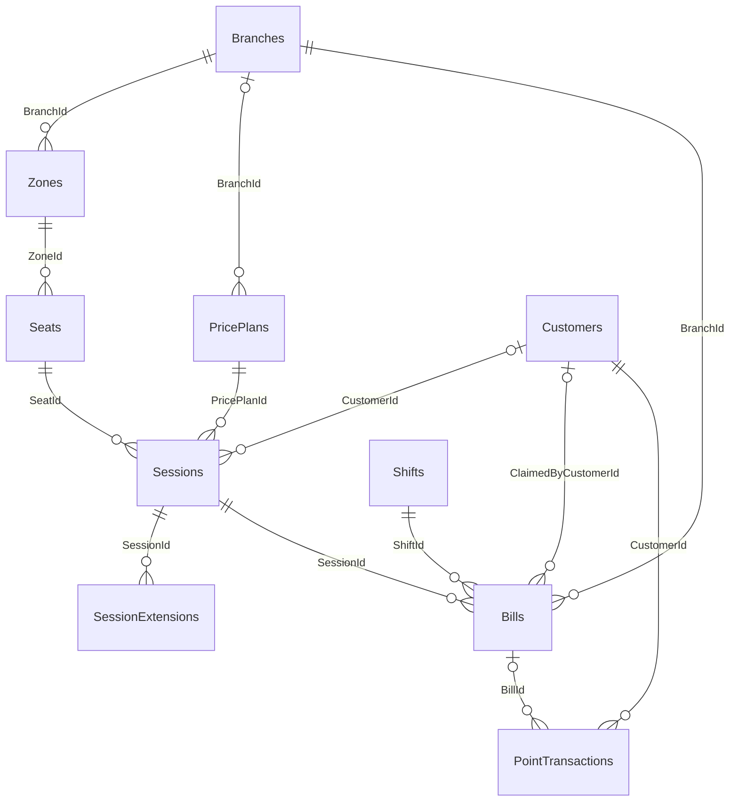
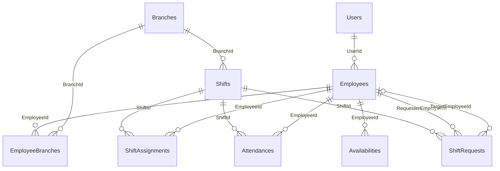
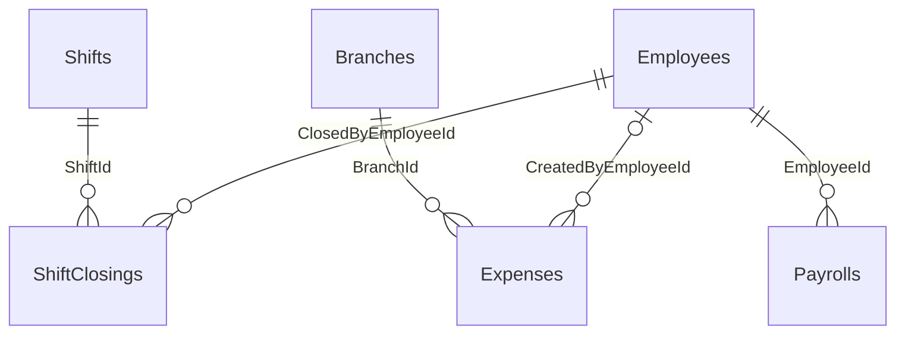
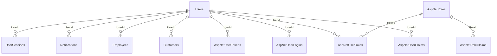

# ERD và bản đồ quan hệ theo `docs/db.sql`

Tài liệu này được dựng từ các `CREATE TABLE`, `PRIMARY KEY` và `FOREIGN KEY` có mặt trong `docs/db.sql`. Sơ đồ thể hiện **schema được khai báo trong chính file SQL này**. Các bảng hệ thống migration được ghi chú riêng.

## 1. Sơ đồ ERD đầy đủ theo FK trong SQL

**Cách đọc ký hiệu Mermaid:** `||` là đúng một bản ghi ở phía cha; `o{` là không hoặc nhiều bản ghi con. Trên FK nullable (ví dụ `BranchId` của `PricePlans`) phía FK có thể không tham chiếu bản ghi cha. Sơ đồ mô tả chiều phụ thuộc theo FK, không đồng nghĩa với uniqueness.

## 2. Danh sách bảng và khóa

Tất cả bảng nghiệp vụ dưới đây có `Id` làm PK kiểu `uniqueidentifier`, trừ khi ghi rõ PK ghép. Các FK bên dưới lấy từ constraint `FOREIGN KEY` thực tế trong SQL.

### 2.1 Bảng nghiệp vụ

| Bảng | PK | FK trong `db.sql` | Ghi chú |
| --- | --- | --- | --- |
| `Branches` | `Id` | — | Chi nhánh. |
| `Zones` | `Id` | `BranchId → Branches.Id` | Khu vực thuộc chi nhánh. |
| `Seats` | `Id` | `ZoneId → Zones.Id` | Chỗ thuộc khu vực. |
| `PricePlans` | `Id` | `BranchId → Branches.Id` (nullable) | Bảng giá có thể không gắn riêng chi nhánh. |
| `Sessions` | `Id` | `SeatId → Seats.Id`; `CustomerId → Customers.Id` (nullable); `PricePlanId → PricePlans.Id` | Lượt sử dụng chỗ. |
| `SessionExtensions` | `Id` | `SessionId → Sessions.Id` | Bản ghi gia hạn. FK session có `ON DELETE CASCADE`. |
| `Bills` | `Id` | `BranchId → Branches.Id`; `ShiftId → Shifts.Id`; `SessionId → Sessions.Id`; `ClaimedByCustomerId → Customers.Id` (nullable) | Bill gắn chi nhánh, ca, lượt và tùy chọn khách claim. |
| `Customers` | `Id` | `UserId → Users.Id` | Hồ sơ thành viên/khách. |
| `PointTransactions` | `Id` | `CustomerId → Customers.Id`; `BillId → Bills.Id` (nullable) | Lịch sử cộng/trừ điểm. |
| `Employees` | `Id` | `UserId → Users.Id` | Hồ sơ nhân viên. |
| `EmployeeBranches` | `Id` | `EmployeeId → Employees.Id`; `BranchId → Branches.Id` | Bảng nối nhân viên và chi nhánh; cả hai FK có `ON DELETE CASCADE`. |
| `Shifts` | `Id` | `BranchId → Branches.Id` | Ca làm tại chi nhánh. Có check `EndAt > StartAt`. |
| `ShiftAssignments` | `Id` | `ShiftId → Shifts.Id`; `EmployeeId → Employees.Id` | Bảng nối nhân viên vào ca. |
| `Attendances` | `Id` | `EmployeeId → Employees.Id`; `ShiftId → Shifts.Id` | Chấm công theo ca. |
| `Availabilities` | `Id` | `EmployeeId → Employees.Id` | Lịch rảnh định kỳ hoặc ngày cụ thể; SQL có hai check constraint về hình thức và khoảng giờ. |
| `ShiftRequests` | `Id` | `ShiftId → Shifts.Id`; `RequesterEmployeeId → Employees.Id`; `TargetEmployeeId → Employees.Id` (nullable); `ReviewedByEmployeeId → Employees.Id` (nullable) | Đơn đổi/nghỉ/trả ca, nhiều FK cùng trỏ Employees với vai trò khác nhau. |
| `ShiftClosings` | `Id` | `ShiftId → Shifts.Id`; `ClosedByEmployeeId → Employees.Id` | Biên bản kết ca. |
| `Expenses` | `Id` | `BranchId → Branches.Id`; `CreatedByEmployeeId → Employees.Id` (nullable) | Khoản chi. |
| `Payrolls` | `Id` | `EmployeeId → Employees.Id` | Bảng lương theo nhân viên. |
| `Notifications` | `Id` | `UserId → Users.Id` | Thông báo tài khoản. |
| `UserSessions` | `Id` | `UserId → Users.Id`; `BranchId → Branches.Id` (nullable) | Phiên đăng nhập/refresh token. |
| `Users` | `Id` | — | Tài khoản Identity tùy chỉnh. |

### 2.2 Bảng ASP.NET Identity

| Bảng | PK | FK trong `db.sql` | Ý nghĩa |
| --- | --- | --- | --- |
| `AspNetRoles` | `Id` | — | Danh mục role. |
| `AspNetRoleClaims` | `Id` | `RoleId → AspNetRoles.Id` | Claim gắn role. |
| `AspNetUserClaims` | `Id` | `UserId → Users.Id` | Claim gắn user. |
| `AspNetUserLogins` | `(LoginProvider, ProviderKey)` | `UserId → Users.Id` | Đăng nhập ngoài. |
| `AspNetUserRoles` | `(UserId, RoleId)` | `UserId → Users.Id`; `RoleId → AspNetRoles.Id` | Bảng nối user–role. |
| `AspNetUserTokens` | `(UserId, LoginProvider, Name)` | `UserId → Users.Id` | Token Identity. |

`__EFMigrationsHistory` là bảng metadata EF Core, có PK `MigrationId`, không phải bảng nghiệp vụ. Nó không có quan hệ FK trong script.

## 3. Sơ đồ theo nhóm nghiệp vụ

### 3.1 Mặt bằng, lượt sử dụng và hóa đơn

### 3.2 Nhân viên, chi nhánh và lịch làm

### 3.3 Kết ca và tài chính

### 3.4 Tài khoản và role

## 4. Các điểm khác cần lưu ý khi dùng sơ đồ

1. **Sơ đồ này theo SQL dump.** `docs/db.sql` được xuất ngày 31/10/2026, trong khi cấu hình EF/migration trong source có thay đổi mới hơn. Dùng sơ đồ này khi cần mô tả chính xác file SQL; dùng sơ đồ trong tài liệu khác khi muốn mô tả model hiện tại.
2. **SQL dump chỉ liệt kê PK và FK constraints.** Trong phần được cung cấp không thấy các unique indexes từ EF configuration. Vì vậy cardinality trên sơ đồ chỉ thể hiện FK cho phép tham chiếu, không khẳng định quan hệ one-to-one hoặc tính duy nhất ngoài PK.
3. **Một số trường không có FK constraint trong dump:** `Attendances.ApprovedByUserId`, `ShiftClosings.ReviewedByUserId`, `Expenses.CreatedByUserId`, `Expenses.ReversesExpenseId`. Chúng không được vẽ như quan hệ vật lý.
4. Tên trường trong dump có thể khác tên property C# do mapping, ví dụ `Branches.Lat`/`Lng` tương ứng latitude/longitude trong entity.
5. Không vẽ các trường thường như `CreatedAt`, enum status, giá trị tiền, hay token/hash vì đó không phải khóa quan hệ.

## 5. Quy tắc đọc nhanh FK

- Cột `XId` trong bảng con trỏ tới `Id` bảng cha khi có FK constraint được khai báo.
- FK không nullable (`NOT NULL`) nghĩa là bản ghi con bắt buộc tham chiếu bản ghi cha; nullable (`NULL`) cho phép để trống.
- Quan hệ nhiều-nhiều được tách bằng bảng nối: `EmployeeBranches` (nhân viên–chi nhánh), `ShiftAssignments` (nhân viên–ca), `AspNetUserRoles` (user–role).
- `ON DELETE CASCADE` được khai báo trong dump cho các quan hệ Identity phụ thuộc, `EmployeeBranches` và `SessionExtensions`; các FK khác không nêu cascade action nên dùng mặc định SQL Server `NO ACTION`.
