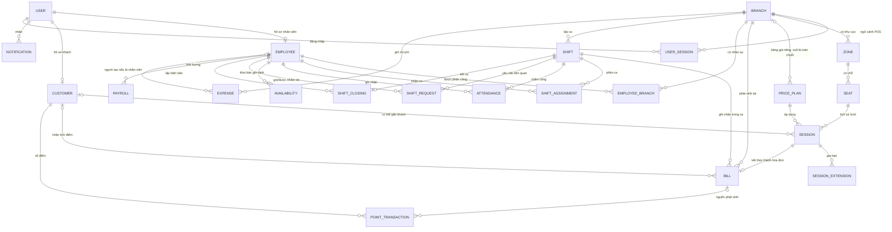
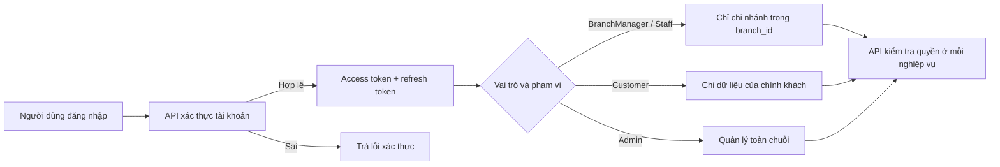
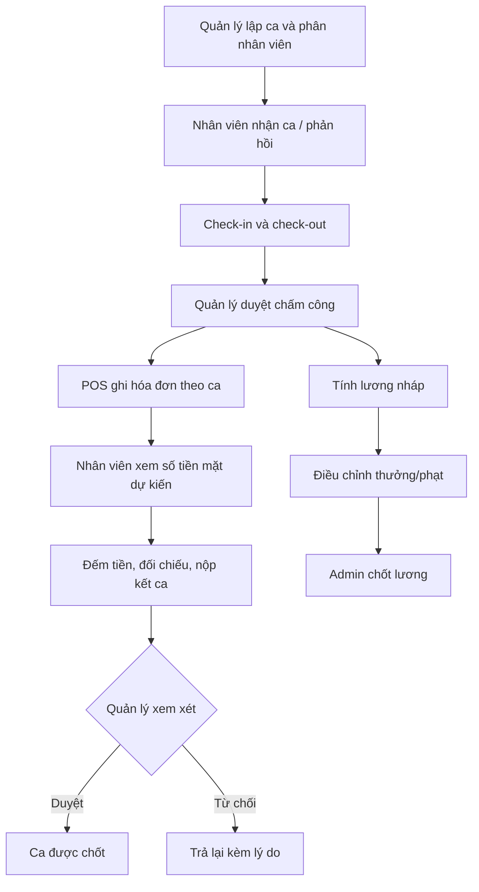
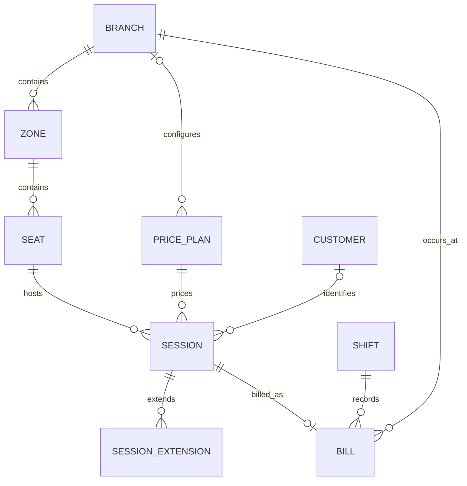
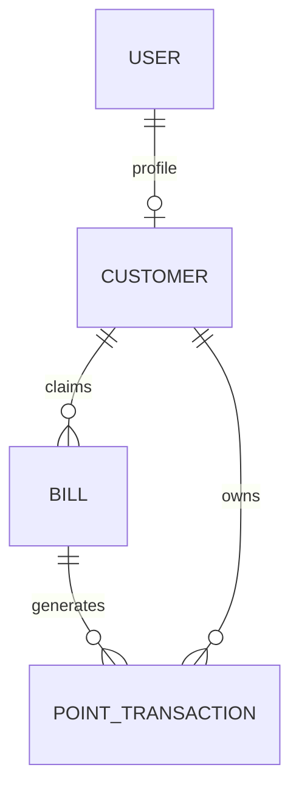
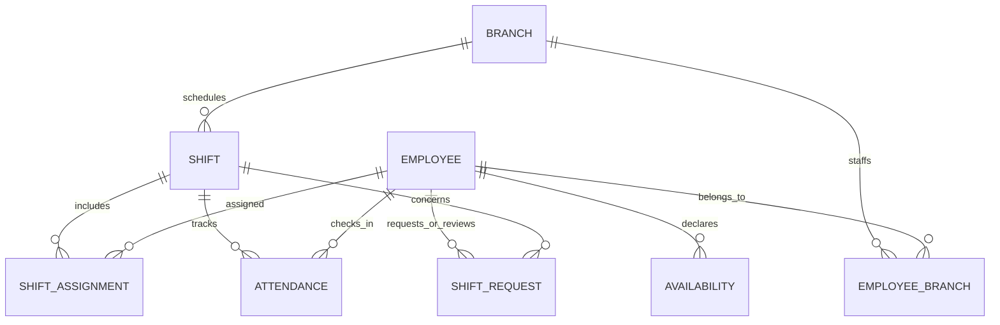
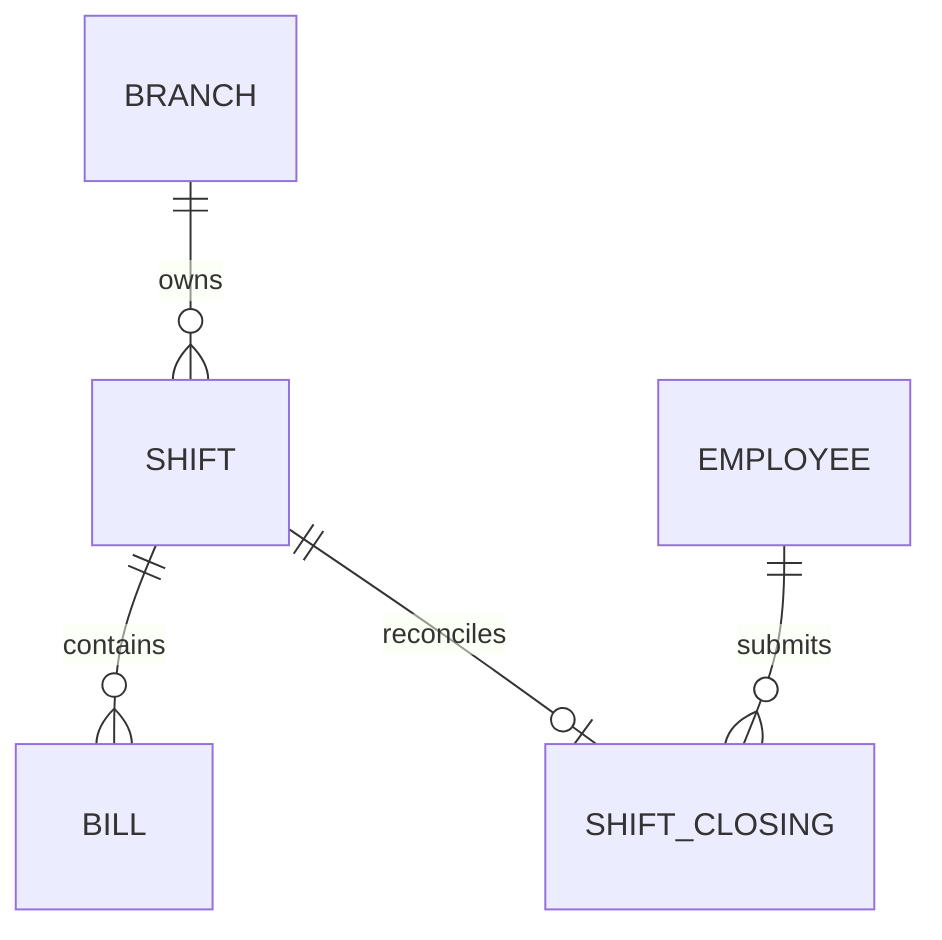
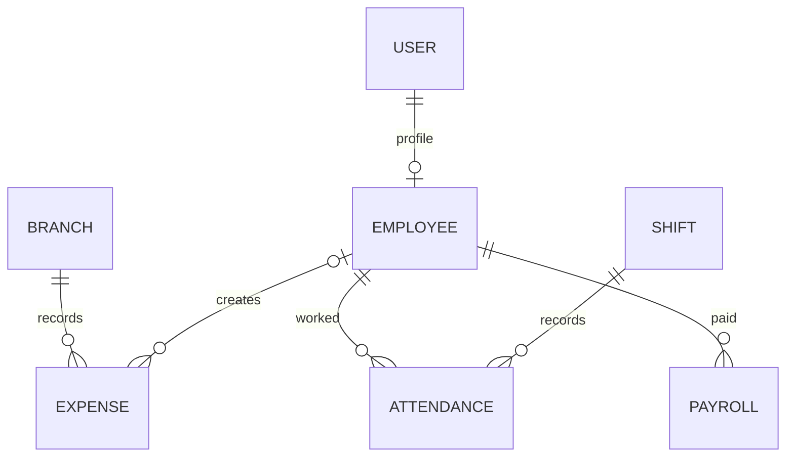

# Tài liệu gợi ý demo và trình bày Cafe CR

>Tài liệu tham khảo cho buổi demo. Nội dung mô tả phạm vi hiện có trong repository; dữ liệu demo là dữ liệu giả lập.

## 1. Giới thiệu ngắn

Cafe CR là công cụ quản lý chuỗi quán cà phê theo chi nhánh. Hệ thống gồm API .NET, SQL Server và ba giao diện React: **Web Quản lý** (`/admin`), **POS Nhân viên** (`/pos`) và **Web Khách hàng** (`/`). Các nghiệp vụ chính gồm quản lý chi nhánh/chỗ ngồi/bảng giá, ca làm và chấm công, lượt sử dụng chỗ và hóa đơn, tích điểm, kết ca, chi phí, lương và báo cáo.

## 2. ERD tổng quan

ERD dưới đây tập trung vào 22 entity nghiệp vụ. Khóa chính của entity nghiệp vụ là `Id` kiểu GUID. Các bảng ASP.NET Identity và `UserSessions` hỗ trợ tài khoản/đăng nhập, được lược bớt khỏi sơ đồ để dễ trình bày.

### Nhóm bảng cần giải thích

| Nhóm | Entity | Ý nghĩa |
| --- | --- | --- |
| Tài khoản và phạm vi | `User`, `Employee`, `Customer`, `EmployeeBranch`, `UserSession` | Một tài khoản có thể có hồ sơ nhân viên hoặc khách hàng. `EmployeeBranch` nối nhân viên với một/nhiều chi nhánh và đánh dấu chi nhánh chính. |
| Cơ sở vật chất và giá | `Branch`, `Zone`, `Seat`, `PricePlan` | Chi nhánh có khu vực, khu vực có chỗ. Bảng giá có thể áp dụng toàn chuỗi (`BranchId` rỗng) hoặc riêng chi nhánh. |
| Bán hàng và thành viên | `Session`, `SessionExtension`, `Bill`, `PointTransaction`, `Customer` | Lượt sử dụng chỗ giữ giờ bắt đầu/kết thúc và trạng thái; gia hạn ghi riêng; hóa đơn liên kết lượt ngồi. Giao dịch điểm là lịch sử cộng/trừ điểm. |
| Nhân sự | `Shift`, `ShiftAssignment`, `Attendance`, `Availability`, `ShiftRequest` | Ca thuộc chi nhánh; phân công nối ca và nhân viên; chấm công lưu giờ vào/ra; yêu cầu đổi/nghỉ ca được quản lý duyệt. |
| Tài chính | `ShiftClosing`, `Expense`, `Payroll` | Biên bản đối chiếu tiền mặt theo ca; chi phí có thể đảo bằng bút toán mới; lương tổng hợp từ chấm công đã duyệt. |
| Tương tác | `Notification` | Thông báo trong ứng dụng gắn với tài khoản người dùng. |

**Quan hệ đáng chú ý:** `Shift` ↔ `Employee` là quan hệ nhiều-nhiều thông qua `ShiftAssignment`; `Employee` ↔ `Branch` cũng là nhiều-nhiều qua `EmployeeBranch`. Mỗi chỗ chỉ được có tối đa một lượt đang diễn ra. Hóa đơn lưu phương thức thanh toán mô phỏng; dự án hiện không tích hợp cổng thanh toán hay webhook.

## 3. Luồng logic cơ bản

### A. Đăng nhập và phân quyền

Vai trò hiện có: `Admin`, `BranchManager`, `Staff`, `Customer`. Phạm vi nhân viên/quản lý chi nhánh lấy từ phân công `EmployeeBranch` và được đưa vào access token; token có hạn mặc định 15 phút. Refresh token được xoay vòng. Đăng ký khách tự phục vụ đã có; xác minh email chưa triển khai.

### B. Nhân viên tiếp nhận khách tại POS

1. Nhân viên đăng nhập, chọn chi nhánh/ca làm; API kiểm tra nhân viên được phân công tại chi nhánh và đang tham gia ca.
2. POS tải sơ đồ tầng. API hiển thị chỗ trống, đang sử dụng, sắp hết giờ (còn tối đa 15 phút), quá giờ hoặc bảo trì.
3. Nhân viên chọn chỗ trống, bảng giá và có thể tìm/gắn hồ sơ thành viên.
4. API tạo lượt `Session` và `Bill` trong cùng giao dịch; chỗ không thể bị mở hai lượt hoạt động đồng thời. Hóa đơn ghi nhận tiền mặt hoặc VietQR mô phỏng.
5. Khi khách gia hạn, thời lượng và phí gia hạn được cộng vào lượt/hóa đơn. Khi trả chỗ, lượt được đóng và chỗ trở lại trạng thái trống.
6. Khách có tài khoản có thể nhập mã hóa đơn để nhận điểm; mỗi bill chỉ nhận một lần, trong 7 ngày. Tỷ lệ hiện tại: 1.000đ = 1 điểm.

### C. Ca làm, kết ca và tài chính

Số tiền mặt dự kiến là tổng bill tiền mặt thuộc ca. Nếu có chênh lệch, khi nộp biên bản kết ca phải ghi chú. Lương dựa trên chấm công đã duyệt: giờ công × lương giờ + phụ cấp giờ đêm (22:00–06:00) + thưởng − khấu trừ. Khoản chi đã ghi được sửa sai bằng bút toán đảo có tham chiếu khoản gốc, thay vì xóa lịch sử.

### D. Quản lý và báo cáo

Quản lý thiết lập khu vực, chỗ ngồi, bảng giá; xếp ca, duyệt chấm công/yêu cầu nhân viên/kết ca; theo dõi chi phí, lương và báo cáo. Dashboard/báo cáo có doanh thu, công suất sử dụng, lãi lỗ (doanh thu − chi phí − lương), so sánh chi nhánh. BranchManager bị giới hạn ở chi nhánh đã được cấp; Admin có thể xem toàn chuỗi.

## 4. Gợi ý trình tự demo (5–8 phút)

1. **Nêu bài toán:** quản lý hoạt động nhiều chi nhánh và luồng từ tiếp nhận khách tới đối soát ca.
2. **Mở giao diện khách:** xem chi nhánh, số chỗ trống và bảng giá công khai.
3. **Mở POS:** xem sơ đồ chỗ; tạo một lượt cho khách, thử gia hạn hoặc đóng lượt; giải thích hóa đơn và tích điểm.
4. **Mở quản lý:** xem dashboard, lịch ca/chấm công và một biên bản kết ca; chỉ ra báo cáo theo chi nhánh.
5. **Chốt bằng ERD:** đi theo chuỗi `Branch → Zone → Seat → Session → Bill → PointTransaction`, rồi nối `Shift → Attendance → ShiftClosing/Payroll`.

Nếu chỉ có ít thời gian, ưu tiên trình diễn POS và giải thích ERD theo hai chuỗi trên. Dùng dữ liệu đã seed sẵn sẽ ổn định hơn thao tác tạo nhiều dữ liệu trong lúc trình bày.

## 5. Câu hỏi giáo viên có thể hỏi

| Câu hỏi | Gợi ý trả lời |
| --- | --- |
| Vì sao dùng `EmployeeBranch` thay vì để `BranchId` trực tiếp trong `Employee`? | Một nhân viên có thể làm ở nhiều chi nhánh; bảng nối còn đánh dấu được chi nhánh chính. |
| Làm sao tránh hai nhân viên nhận cùng một chỗ? | API và cơ sở dữ liệu bảo đảm chỉ một session đang hoạt động trên mỗi seat; xung đột trả lỗi thay vì tạo bill/session trùng. |
| Khách không đăng nhập có dùng dịch vụ được không? | POS có thể tạo lượt/bill mà không gắn customer; việc tự xem điểm và tự claim bill yêu cầu tài khoản khách. |
| Phân quyền theo chi nhánh hoạt động thế nào? | Token chứa các `branch_id` lấy từ phân công nhân viên. Endpoint kiểm tra quyền và truy vấn trong phạm vi đó. |
| Nếu đổi quyền nhân viên thì token cũ ra sao? | Claim là ảnh chụp tại thời điểm cấp; access token cũ có thể còn hiệu lực tới khi hết hạn (mặc định 15 phút), refresh sẽ đọc quyền mới. |
| Công thức tích điểm và lương là gì? | Điểm: 1.000đ/bill = 1 điểm theo quy tắc hiện tại. Lương: giờ công × lương giờ + phụ cấp đêm + thưởng − khấu trừ; chỉ chấm công đã duyệt được tính. |
| Dữ liệu demo có phải dữ liệu kinh doanh thật không? | Không. Seed chỉ chạy bằng lệnh tường minh trong môi trường Development/Testing; giá và tài khoản là dữ liệu giả lập. |
| Có tích hợp thanh toán VietQR thật chưa? | Chưa. `PaymentMethod` chỉ ghi nhận hình thức thanh toán mô phỏng; không có cổng thanh toán/webhook. |
| Cơ sở dữ liệu cập nhật schema khi chạy app không? | Không tự động. Dùng EF Core migration có chủ đích để kiểm soát thay đổi schema. |
| Hạn chế hiện tại? | Chưa xác minh email do chưa có dịch vụ email; đây là prototype, chưa đủ cấu hình để mở đăng ký công khai production. Một số luồng demo dùng giá và lịch sử giả lập. |

## 6. Lưu ý khi trình bày

- Nên gọi đây là **prototype/hệ thống demo** và phân biệt tính năng mô phỏng với tích hợp thật.
- Tránh đưa mật khẩu, JWT signing key hoặc file `.env` lên màn hình/chia sẻ. Password hash, PIN hash và hash refresh token không được trả về API.
- Một số luồng cần dữ liệu đã tạo sẵn và tài khoản đúng vai trò. Kiểm tra trước chi nhánh, ca hiện hành và phiên đăng nhập để tránh mất thời gian.
- Backend có Swagger tại `/swagger`; ba web app nằm ở `/`, `/admin`, `/pos` khi chạy qua Compose.

## 7. Nguồn đối chiếu trong repository

- `README.md`: kiến trúc chạy, seed demo, vai trò và bảo mật.
- `spec.md`: phạm vi sản phẩm và các quyết định nền tảng.
- `backend/src/ChonRieng.Domain/Entities/`: cấu trúc entity nghiệp vụ.
- `backend/src/ChonRieng.Api/Features/`: endpoint và nghiệp vụ POS, catalog, tài chính, báo cáo.

## 8. Chi tiết bảng: PK, FK và điểm cần nhớ

`PK` là khóa chính, `FK` là khóa ngoại. Các bảng nghiệp vụ có `Id` làm PK kiểu GUID, trừ khi ghi chú khác. Các FK được liệt kê dưới đây là quan hệ được cấu hình trong EF Core. Một số trường có tên giống FK nhưng hiện chỉ là giá trị tham chiếu, chưa cấu hình constraint FK trong model.

### 8.1 Tài khoản, nhân sự và chi nhánh

| Bảng | PK | FK | Ràng buộc / ghi chú |
| --- | --- | --- | --- |
| `Users` | `Id` | — | Bảng Identity tùy chỉnh, có `FullName`. Email chuẩn hóa và số điện thoại có unique filtered index khi khác null. Identity còn có các bảng role/claim/login/token hỗ trợ. |
| `Employees` | `Id` | `UserId → Users.Id` | `UserId` unique: một user tối đa một hồ sơ nhân viên. Lưu `HourlyRate`, `NightAllowance`, `PinHash`; không trả hash qua API. |
| `Customers` | `Id` | `UserId → Users.Id` | `UserId` unique; `MemberCode` unique khi khác null. Lưu số điểm hiện tại, hạng, tổng chi tiêu. |
| `Branches` | `Id` | — | Cơ sở kinh doanh; lưu địa chỉ, tọa độ, giờ hoạt động và trạng thái. |
| `EmployeeBranches` | `Id` | `EmployeeId → Employees.Id`; `BranchId → Branches.Id` | Unique cặp `(EmployeeId, BranchId)`; filtered unique đảm bảo tối đa một dòng `IsHome = true` mỗi nhân viên. Đây là bảng nối nhân viên–chi nhánh. |
| `UserSessions` | `Id` | `UserId → Users.Id`; `BranchId → Branches.Id` (nullable) | Lưu hash refresh token, thiết bị, POS/chi nhánh, hết hạn/thu hồi; không lưu refresh token dạng rõ. Unique filtered cho phiên POS chưa thu hồi của user. |
| `Notifications` | `Id` | `UserId → Users.Id` | Thông báo thuộc một user; có loại, nội dung, link, thời điểm tạo/đọc. |

### 8.2 Khu vực, bảng giá và bán hàng

| Bảng | PK | FK | Ràng buộc / ghi chú |
| --- | --- | --- | --- |
| `Zones` | `Id` | `BranchId → Branches.Id` | Unique `(BranchId, Name)`; khu vực nằm trong một chi nhánh. |
| `Seats` | `Id` | `ZoneId → Zones.Id` | Unique `(ZoneId, Code)`; `Type` và `Status` lưu enum dạng byte. Trạng thái gồm trống, đang dùng, bảo trì. |
| `PricePlans` | `Id` | `BranchId → Branches.Id` (nullable) | `BranchId = null` nghĩa là bảng giá toàn chuỗi; giá tiền là số nguyên VND (`decimal(12,0)`), có thời lượng và khoảng hiệu lực. |
| `Sessions` | `Id` | `SeatId → Seats.Id`; `CustomerId → Customers.Id` (nullable); `PricePlanId → PricePlans.Id` | Unique filtered index trên `SeatId` khi `Status = Active`: tối đa một lượt hoạt động trên một chỗ. Lưu giờ bắt đầu/kết thúc, trạng thái, giờ đóng. |
| `SessionExtensions` | `Id` | `SessionId → Sessions.Id` | Mỗi lần gia hạn là một dòng riêng, ghi số phút, phí và thời điểm; xóa session thì extension được cascade theo cấu hình. |
| `Bills` | `Id` | `BranchId → Branches.Id`; `ShiftId → Shifts.Id`; `SessionId → Sessions.Id`; `ClaimedByCustomerId → Customers.Id` (nullable) | Unique `Code` và unique `SessionId`: mã bill không trùng, một session tối đa một bill. `Total`, phương thức thanh toán, khách claim và thời điểm claim. `ClaimedByCustomerId` là concurrency token để tránh claim đồng thời. |
| `PointTransactions` | `Id` | `CustomerId → Customers.Id`; `BillId → Bills.Id` (nullable) | Sổ cái điểm: số điểm dương/âm, lý do, thời điểm; bill có thể null cho điều chỉnh không gắn bill. |

### 8.3 Lịch làm và chấm công

| Bảng | PK | FK | Ràng buộc / ghi chú |
| --- | --- | --- | --- |
| `Shifts` | `Id` | `BranchId → Branches.Id` | Ca thuộc chi nhánh; `EndAt > StartAt`; `RowVersion` dùng optimistic concurrency. Index theo chi nhánh và khoảng giờ. |
| `ShiftAssignments` | `Id` | `ShiftId → Shifts.Id`; `EmployeeId → Employees.Id` | Unique `(ShiftId, EmployeeId)`: không phân công trùng một nhân viên vào cùng ca. Bảng nối ca–nhân viên có trạng thái offered/accepted/declined. |
| `Attendances` | `Id` | `EmployeeId → Employees.Id`; `ShiftId → Shifts.Id` | Unique `(EmployeeId, ShiftId)`: một bản chấm công cho nhân viên trong một ca. Lưu check-in/out, phương thức, trạng thái duyệt. |
| `Availabilities` | `Id` | `EmployeeId → Employees.Id` | Check constraint buộc khai báo theo thứ trong tuần (recurring) hoặc ngày cụ thể (specific), không đồng thời; `From < To`. |
| `ShiftRequests` | `Id` | `ShiftId → Shifts.Id`; `RequesterEmployeeId → Employees.Id`; `TargetEmployeeId → Employees.Id` (nullable); `ReviewedByEmployeeId → Employees.Id` (nullable) | Yêu cầu đổi/nghỉ/bỏ ca; ba FK nhân viên có vai trò khác nhau. Trạng thái là chuỗi. |

### 8.4 Kết ca, chi phí và lương

| Bảng | PK | FK | Ràng buộc / ghi chú |
| --- | --- | --- | --- |
| `ShiftClosings` | `Id` | `ShiftId → Shifts.Id`; `ClosedByEmployeeId → Employees.Id` | Unique `ShiftId`: tối đa một biên bản/ca. Lưu tiền dự kiến, đếm được, chênh lệch, mệnh giá JSON, trạng thái và thông tin review. `ReviewedByUserId` là scalar, chưa cấu hình FK trong entity mapping hiện tại. |
| `Expenses` | `Id` | `BranchId → Branches.Id`; `CreatedByEmployeeId → Employees.Id` (nullable) | Có index `(BranchId, Date)`. `CreatedByUserId` và `ReversesExpenseId` hiện là scalar chưa cấu hình FK constraint; `ReversesExpenseId` có unique filtered index để tối đa một bút toán đảo trên mỗi giá trị gốc. |
| `Payrolls` | `Id` | `EmployeeId → Employees.Id` | Unique `(EmployeeId, Month)`: một bảng lương mỗi nhân viên/tháng. Lưu tổng giờ, lương cơ bản, phụ cấp, thưởng, khấu trừ, thực nhận và trạng thái. |

> **Ghi chú khi bảo vệ:** ở bản model hiện tại, `Attendance.ApprovedByUserId`, `ShiftClosing.ReviewedByUserId`, `Expense.CreatedByUserId` và `Expense.ReversesExpenseId` chưa được khai báo quan hệ FK trong EF configuration. Có thể trình bày đây là các trường tham chiếu nghiệp vụ/audit ở phiên bản hiện tại, đồng thời nêu rõ đây là điểm có thể hoàn thiện bằng FK constraint nếu cần tăng toàn vẹn tham chiếu.

## 9. ERD theo use case chính

Các sơ đồ này là lát cắt từ ERD tổng quan, chỉ giữ bảng tham gia trực tiếp vào từng nghiệp vụ.

### 9.1 Tiếp nhận khách, tính tiền và gia hạn tại POS

**Khóa nối của luồng:** `Seats.Id → Sessions.SeatId`, `PricePlans.Id → Sessions.PricePlanId`, `Sessions.Id → Bills.SessionId`, `Shifts.Id → Bills.ShiftId`. Quan hệ `Bill.SessionId` là unique nên một lượt chỉ có tối đa một hóa đơn.

### 9.2 Khách claim hóa đơn và theo dõi điểm

Khách gửi mã bill đã nhận ở POS. API xác minh hóa đơn còn trong thời hạn, chưa được claim và gắn với tài khoản hiện tại; sau đó cập nhật khách claim và ghi giao dịch điểm. Endpoint khách hàng áp dụng quyền sở hữu tài nguyên và giới hạn tần suất chống dò mã.

### 9.3 Quản lý phân ca và chấm công

`ShiftAssignments` là cầu nối phân ca. `Availabilities` là dữ liệu khai báo thời gian có thể làm, không đồng nghĩa với phân ca đã xác nhận. `Attendance` là dữ liệu thực tế vào/ra ca và được dùng làm nguồn tính lương sau khi duyệt.

### 9.4 Kết ca và duyệt đối soát

Hệ thống cộng các bill tiền mặt theo `ShiftId` để ra tiền dự kiến. Nhân viên nhập tiền đếm được và mệnh giá, sau đó nộp biên bản. Quản lý duyệt hoặc từ chối với lý do; mỗi ca tối đa một closing record.

### 9.5 Chi phí và tính lương

Báo cáo lãi lỗ tổng hợp doanh thu từ bill, chi phí từ `Expenses` và chi phí lương từ `Payrolls`. Lương được tạo theo nhân viên/tháng từ các chấm công đã duyệt; bảng lương đã chốt không được tạo lại/ghi đè theo luồng nghiệp vụ.
