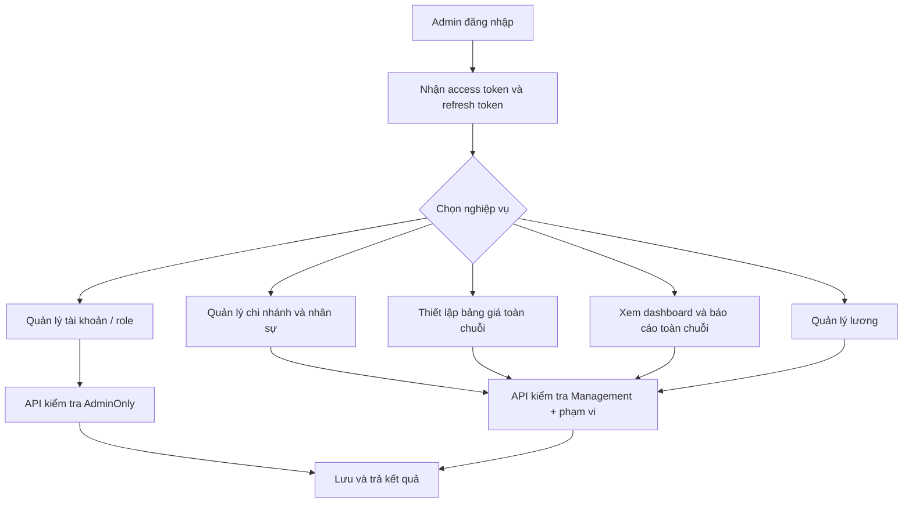
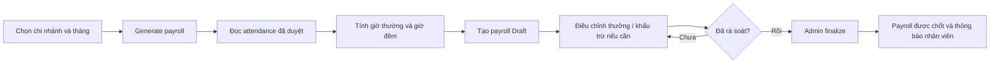
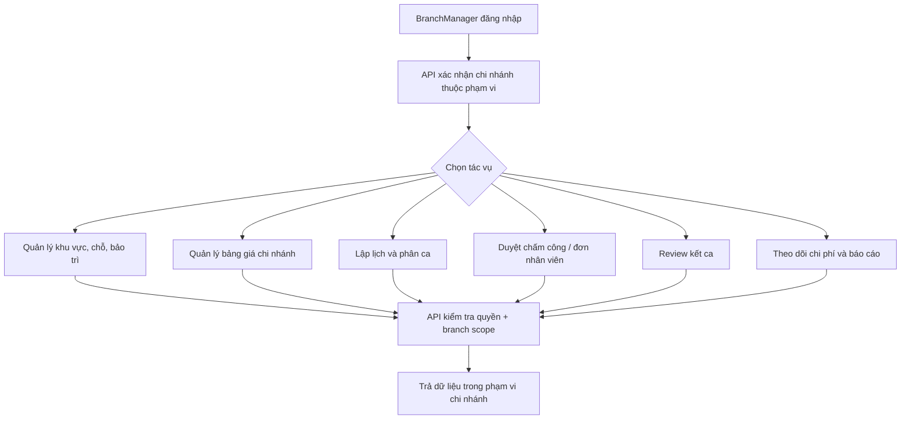
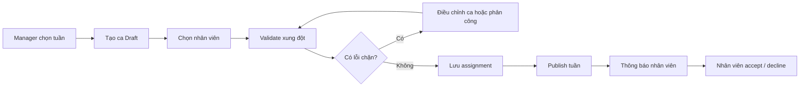
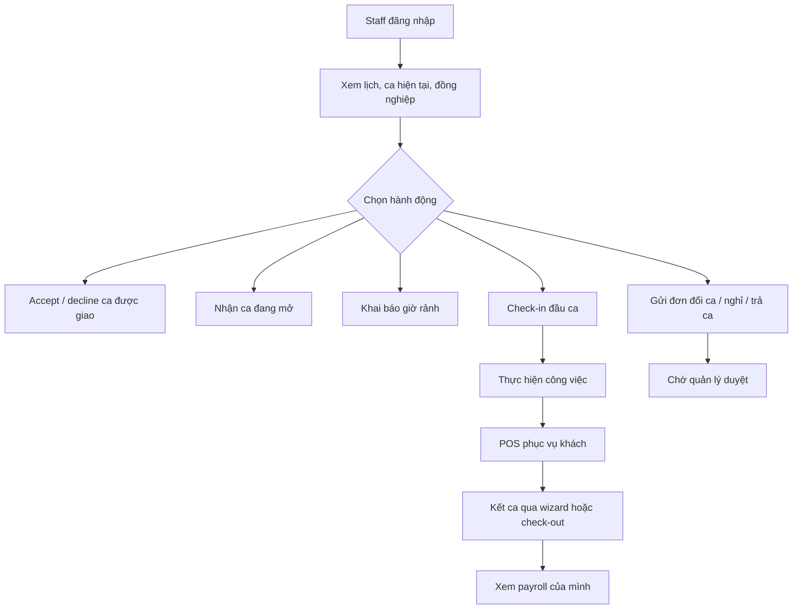
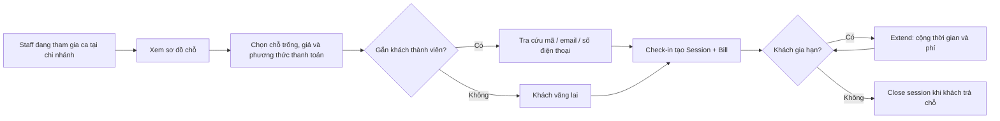
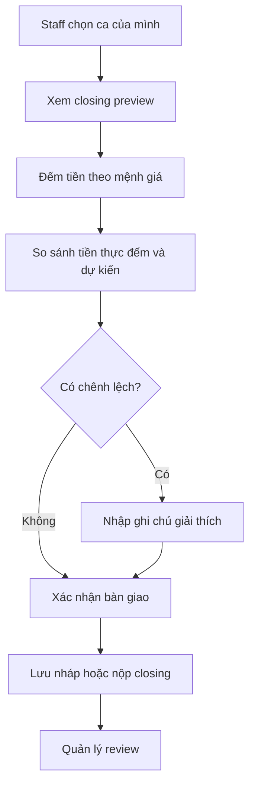
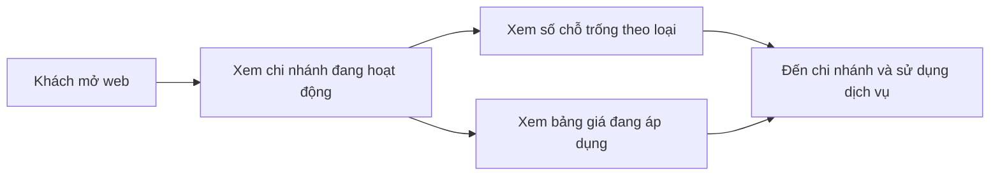
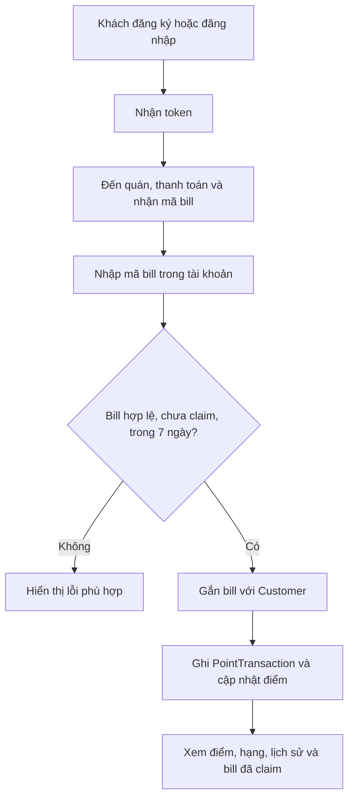

# Luồng Use Case theo vai trò – Cafe CR

Tài liệu này mô tả cách từng vai trò sử dụng các chức năng đang có trong Cafe CR, dựa trên các endpoint và policy hiện tại. Đây là sơ đồ luồng nghiệp vụ mức cơ bản, không phải đặc tả mọi trường hợp lỗi.

## 1. Vai trò và phạm vi

| Vai trò | Mục đích chính | Phạm vi |
| --- | --- | --- |
| `Admin` | Quản trị toàn chuỗi, quản lý tài khoản/dữ liệu, báo cáo tổng hợp, chốt lương | Toàn hệ thống; một số thao tác quản trị CRUD hiện chỉ Admin |
| `BranchManager` | Vận hành chi nhánh: lịch ca, nhân viên, giá/chỗ, duyệt và tài chính chi nhánh | Chi nhánh được gán trong `EmployeeBranch` |
| `Staff` | Làm ca, phục vụ khách tại POS, nhận lịch và gửi yêu cầu | Chi nhánh được gán; chỉ dữ liệu/ca của bản thân hoặc ca thuộc phạm vi |
| `Customer` | Tra cứu chi nhánh, sử dụng tài khoản khách và tích điểm | Dữ liệu của chính khách hàng |

Các role workforce là `Admin`, `BranchManager`, `Staff`; nhóm quản lý gồm `Admin`, `BranchManager`. Một user có thể có nhiều role. API vẫn kiểm tra branch scope hoặc quyền sở hữu dữ liệu bên trong service, không chỉ dựa trên giao diện.

## 2. Use case của Admin

### 2.1 Quản trị chuỗi và tài khoản

**Các thao tác chính:**

- Bootstrap Admin đầu tiên được tạo từ cấu hình môi trường; các tài khoản hiện có không tự bị đổi khi cấu hình thay đổi.
- Admin quản lý người dùng và các business resource qua `/api/admin/*`. Generic CRUD là API nền, chỉ Admin được truy cập; đây không thay thế các luồng nghiệp vụ có kiểm tra riêng.
- Có thể gán nhân viên vào nhiều chi nhánh, chọn chi nhánh chính, tạo bảng giá toàn chuỗi (`BranchId = null`) và xem báo cáo tổng hợp.
- Có thể tạo/chỉnh sửa lương nháp, chốt lương. Chốt lương hiện là thao tác Admin-only.

### 2.2 Chốt lương tháng

Lương gồm giờ công × lương giờ, phụ cấp giờ đêm (22:00–06:00), thưởng và khấu trừ. Payroll đã chốt không được tính lại theo luồng tạo nháp.

## 3. Use case của BranchManager

### 3.1 Vận hành chi nhánh

**Ví dụ các luồng thường dùng:**

- **Cấu hình mặt bằng:** tạo `Zone`, thêm `Seat`, đổi trạng thái bảo trì. Không thể bật bảo trì khi chỗ đang có khách; chỉ xóa khu vực/chỗ khi điều kiện nghiệp vụ cho phép.
- **Giá:** tạo hoặc sửa bảng giá cho chi nhánh mình. Bảng giá toàn chuỗi chỉ Admin được tạo.
- **Lịch:** tạo ca nháp, kiểm tra xung đột trước khi phân nhân viên, giao ca, công bố tuần. Quy tắc kiểm tra gồm trùng ca, branch, nghỉ phép, thời gian nghỉ giữa ca/di chuyển và cảnh báo giờ tuần.
- **Nhân viên:** gán chi nhánh, cập nhật lương giờ/phụ cấp; duyệt chấm công và đơn đổi/nghỉ/trả ca.
- **Tài chính:** xem và duyệt/từ chối closing, tạo chi phí hoặc ghi bút toán đảo, xem doanh thu/lấp đầy/lãi lỗ trong scope.

### 3.2 Lập và công bố lịch tuần

Có thể sao chép lịch tuần. Nhân viên cũng có thể nhận ca đang mở; ca nhận theo nguyên tắc ai nhận trước được trước.

## 4. Use case của Staff

### 4.1 Nhận ca, điểm danh và gửi yêu cầu

**Điểm cần nhớ:** check-in chỉ mở từ 15 phút trước giờ bắt đầu và ca phải được nhận; trễ hơn 10 phút sẽ được đánh dấu đi trễ. Khi decline ca cần nêu lý do. Yêu cầu nghỉ/đổi/trả ca được gửi cho quản lý, sau khi duyệt lịch có thể được cập nhật và các bên được thông báo.

### 4.2 POS: nhận khách và đóng lượt

Check-in session và bill được ghi trong cùng một giao dịch. Nếu chỗ vừa được một POS khác nhận thì API trả xung đột để tránh bán trùng. Staff được tra cứu bill theo mã. Việc ghi nhận phương thức thanh toán hiện là mô phỏng, chưa gọi cổng thanh toán.

### 4.3 Wizard kết ca

Tiền mặt dự kiến bằng tổng bill tiền mặt trong ca. Nộp closing hoàn tất bước rời ca; nếu chênh lệch thì bắt buộc ghi chú. Nhân viên có thể xem payroll của chính mình theo tháng.

## 5. Use case của Customer

### 5.1 Tìm chi nhánh và xem dịch vụ công khai

Tra cứu chi nhánh, mức độ sẵn chỗ và bảng giá hiện có thể thực hiện công khai, không yêu cầu đăng nhập. Availability công khai chỉ trả số lượng theo loại chỗ, không tiết lộ mã chỗ hoặc thông tin người đang sử dụng.

### 5.2 Tạo tài khoản và claim bill tích điểm

Mỗi bill chỉ được claim một lần, trong 7 ngày; endpoint giới hạn 10 lần/phút để chống dò mã. Quy tắc hiện tại là 1.000đ = 1 điểm. Đăng ký khách tự phục vụ đã có, nhưng xác minh email chưa triển khai. Customer chỉ xem tài nguyên của chính mình.

## 6. Ma trận quyền rút gọn

| Chức năng | Admin | BranchManager | Staff | Customer |
| --- | --- | --- | --- | --- |
| Xem chi nhánh/availability/bảng giá công khai | Có | Có | Có | Có |
| Web quản trị / báo cáo | Toàn chuỗi | Chi nhánh được cấp | Không | Không |
| CRUD generic `/api/admin/*` | Có | Không | Không | Không |
| Quản lý mặt bằng và bảng giá | Toàn chuỗi/quản lý | Chi nhánh được cấp | Không | Không |
| Lập lịch, phân ca, duyệt chấm công/đơn | Có | Chi nhánh được cấp | Chỉ thao tác cá nhân (nhận/đáp ca, điểm danh, gửi yêu cầu) | Không |
| POS sessions và bills | Workforce; theo scope | Workforce; theo scope | Có trong ca/chi nhánh hợp lệ | Không trực tiếp |
| Nộp/review kết ca | Nộp theo quyền workforce; review quản lý | Nộp/review trong scope | Nộp ca mình | Không |
| Chi phí và quản lý payroll | Có; finalize payroll Admin-only | Chi nhánh được cấp (không finalize) | Chỉ xem payroll của mình | Không |
| Claim bill, điểm, lịch sử khách | Không qua customer-only API trừ khi user cũng có Customer role | Tương tự | Tương tự | Chỉ tài khoản của mình |

## 7. Quy tắc xác thực/phân quyền xuyên suốt

1. Người dùng đăng nhập qua `/api/auth/login`; đăng ký tự phục vụ tạo tài khoản Customer. API cấp access token và refresh token.
2. Access token mang role và các `branch_id` snapshot. Thời hạn mặc định của access token là 15 phút; refresh đọc lại role và phân công hiện tại.
3. `Management` cho Admin/BranchManager; `Workforce` cho Admin/BranchManager/Staff; Customer API yêu cầu role Customer.
4. Service tiếp tục kiểm tra branch scope hoặc resource ownership. Thay đổi quyền/chi nhánh chưa phản ánh vào access token đã cấp cho tới khi token hết hạn; refresh sẽ lấy quyền mới.
5. Một tài khoản có thể giữ nhiều role, vì vậy một số hành động phụ thuộc cả role và loại hồ sơ đã được provision (Employee/Customer).

## 8. Gợi ý trình bày trước giáo viên

- Dùng một ví dụ xuyên suốt: **Manager lập ca → Staff nhận ca và check-in → phục vụ khách tạo Bill → Customer claim điểm → Staff nộp closing → Manager review → Admin chốt payroll**.
- Ở mỗi bước, chỉ vào bảng liên quan: `Shift`, `ShiftAssignment`, `Attendance`, `Session`, `Bill`, `PointTransaction`, `ShiftClosing`, `Payroll`.
- Nhấn mạnh kiểm tra branch scope ở API, unique constraint ngăn session/bill trùng, và dữ liệu điểm/lương có lịch sử giao dịch.
- Nêu rõ các phần mô phỏng: phương thức thanh toán VietQR chỉ là tender type; chưa tích hợp cổng thanh toán. Xác minh email chưa có do chưa có dịch vụ gửi email.

## 9. Tệp đối chiếu

- [`huong-dan-demo-va-giai-thich.md`](huong-dan-demo-va-giai-thich.md): ERD tổng quan, bảng PK/FK và ERD theo use case.
- `backend/src/ChonRieng.Api/Features/Scheduling/SchedulingEndpoints.cs`: ca, phân công, điểm danh, yêu cầu nhân viên.
- `backend/src/ChonRieng.Api/Features/Sales/SalesEndpoints.cs`: session POS và loyalty Customer.
- `backend/src/ChonRieng.Api/Features/Finance/FinanceEndpoints.cs`: kết ca, chi phí, payroll.
- `backend/src/ChonRieng.Api/Features/Common/Policies.cs`: role policies.
